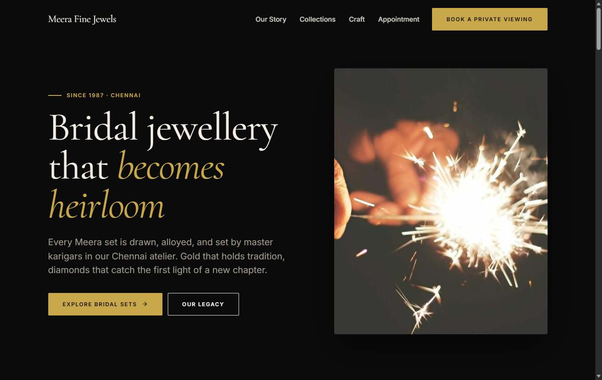
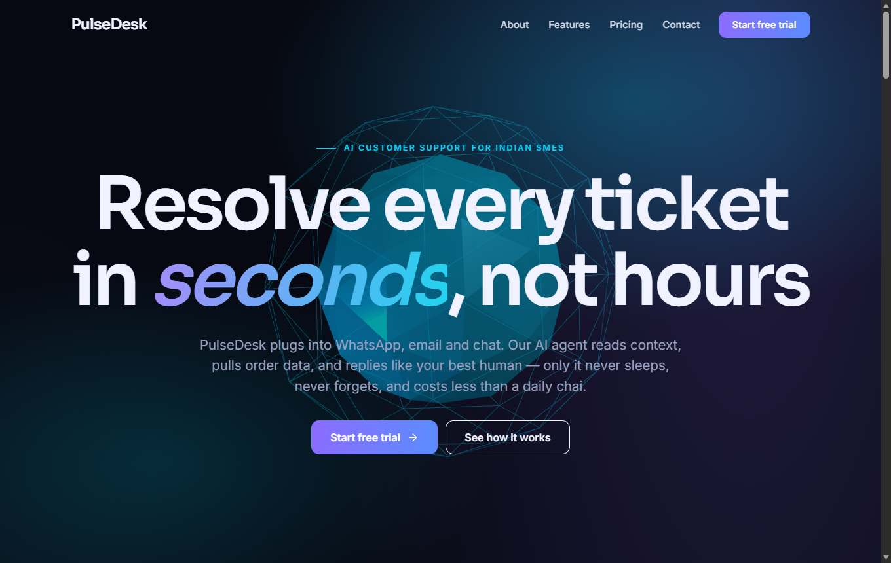
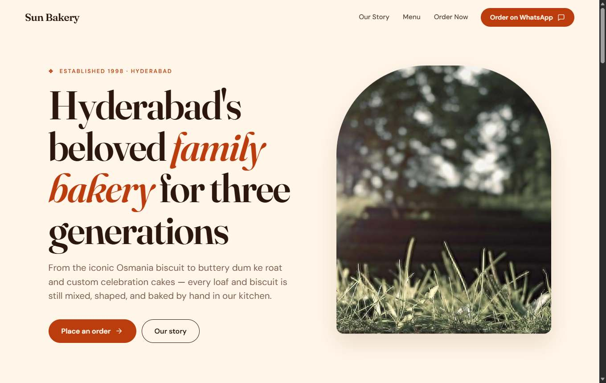
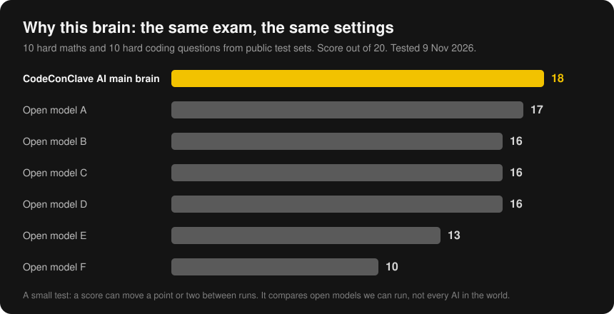
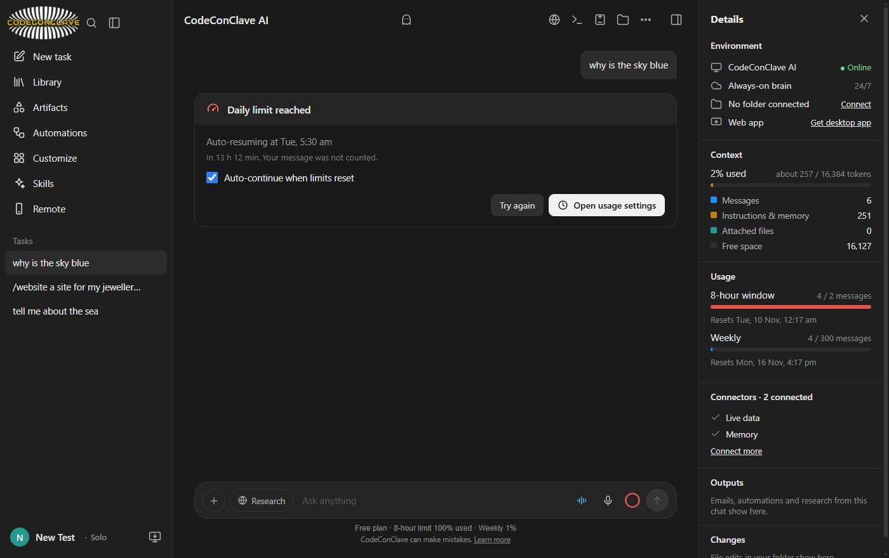

# Saharsh Medidi

Founder of **CodeConClave AI**, India.

---

# CodeConClave AI

### Your Autonomous Intelligence Workspace

**Founder and builder: Saharsh Medidi, India**

**Try it free:** https://codeconclave-ww5x.onrender.com

CodeConClave AI is an AI workspace made in India. You talk to it, and it answers, researches, builds websites, apps and games, makes pictures, videos and documents, and publishes what it builds to a public link.

Every plan gets the same brain, from Free upward. Plans differ only in features and amounts.

---

## What it can do today

| | |
|---|---|
| **Missions** | Give it a goal and it keeps working on our server after you close the page. It asks when it needs a decision, keeps a tamper-evident proof record, and its report marks which lines have proof and which do not. |
| **Bring your chats** | Paste a share link from another AI and carry on here. It says what came across and what could not. |
| **Build websites** | 8 design looks, tested 3D scenes, live data, real pictures. It asks what you want first, then shows the site growing as it is written. |
| **Publish** | One press puts a site on a public link. Updating keeps the same link. Published pages run locked down, with no access to your account. |
| **Build apps and games** | Web apps, tools, dashboards and 2D and 3D games that run right in the chat. |
| **Make files** | Word, Excel, PowerPoint and PDF. Any answer can be saved as Markdown, PDF, Word, a web page or plain text. |
| **Make media** | Pictures, narrated videos, 3D GIFs and audio files. |
| **Read your files** | Drag and drop images, PDFs, Word, Excel, PowerPoint and text. Long files are searched for the parts that matter. |
| **Build anything else** | Phone apps, browser extensions, bots, servers and scripts come out as a complete project with step-by-step instructions, ready to download as a zip. |
| **Live answers** | Weather, air quality, crypto, money rates and more, plus web research with links to where each fact came from. |
| **Browse by itself** | A real cloud browser opens pages, clicks and types. It stops and asks you before anything that pays, signs in, sends or deletes. |
| **Keep going** | Automations run on a schedule. When a limit resets, your request can carry on by itself. |

---

## What it builds

These pages were written by the builder using the CodeConClave design kit. The photos in these samples are stand-ins; the real app makes its own pictures.

---

## The brain, in real numbers

These are real scores from our own exam, using public test sets. We publish numbers we measured, and only those.

---

## Free to try

- 5 messages every 8 hours on the Free plan
- 2 pictures, 1 video or GIF and 2 audio files a day without a logo
- If a limit is reached, the app shows when it comes back and can carry on by itself

---

## Rules we build by

- **No fakes.** If something did not happen, the app does not say it did.
- **It asks first.** Sending, publishing, paying and deleting always wait for your yes.
- **Your passwords and card numbers never reach the brain.** The app hides them first.
- **Pages that ask for passwords or card details cannot be published here.**
- **Files say where they came from.** Every picture, video, GIF and audio file made here carries a hidden label saying it is AI-made, with no personal details.

---

## Still in progress

- Paid plans: payments through Razorpay open soon, and nothing is charged today
- Sign-in to outside apps through connectors: built, with real accounts still to be tested
- A shorter web address of our own

---

## Contact

Saharsh Medidi: medidisaharsh@gmail.com

Made in India.
